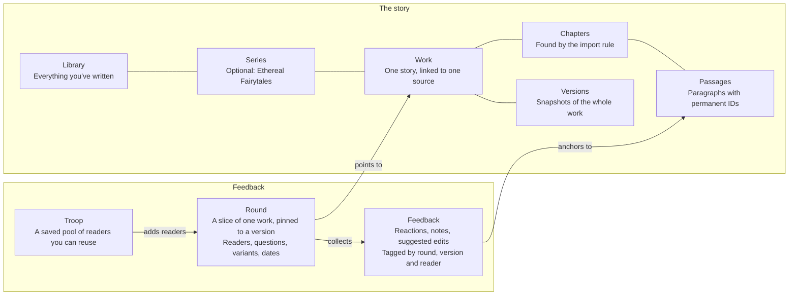
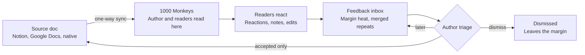

# 1000 Monkeys — Project Doc

Nov 9, 2026 · @Doug

## Summary

1000 Monkeys is a simple, comfortable reader for your own work. You read your draft like a finished book, jot notes and make light edits as you go, and the changes sync back to Notion or Google Docs, or save to your 1000 Monkeys library.

Feedback is the upgrade. A free account can share a piece with up to two readers for simple reactions and notes. The paid tier opens full beta rounds: more readers, triage, version history, and the features nobody else has, like intent vs. reception.

**The name.** It comes from the old line about monkeys at typewriters eventually writing Shakespeare. Here the readers are the monkeys, helping a story get written. It began as a fictional publisher I invented for a logo assignment in design school, and it's the imprint I plan to publish Ethereal Fairytales under: 1000 Monkeys Publishing Co.

## Problem

Reading your own draft the way a reader would is one of the best revision tricks there is. The tooling for it is held together with tape.

- **Writers already hack it together.** One writer converts drafts to EPUB and sends them to Apple Books, because the draft reads like a different book there and can't be edited, only lightly marked up ([source](https://edan.substack.com/p/dispatch-28-flashbacks-revision-and/comments)). Scrivener users follow guides to push drafts to a Kindle or Kobo and revise from the highlights ([source](https://kirkville.com/how-to-revise-the-draft-of-your-scrivener-project-on-an-ebook-reader/)).
- **The round trip is the broken part.** Highlights get stuck on the e-reader. Notes are carried back by hand.
- **Versions pile up as copies.** My own setup: one long Notion page per story, chapters under headings or toggles, and old versions lived in nested toggles until exporting got too painful to keep doing it.
- **Beta feedback scatters.** Email threads, Word files, chat messages. Nothing ties a reader's reaction to the sentence it's about.

## Who it's for

Writers are the customer. Everyone else is someone the writer brings along.

| Who | What they need | Pays? | Phase |
| --- | --- | --- | --- |
| **Writers revising** (primary) | Read the draft like a finished book, mark problems in place, get notes back to where they write | Yes | 1–2 |
| **Beta readers** | A pleasant reading experience with no account, and quick ways to react | No | 2 |
| **Illustrators** | See the manuscript, drop sketches into art slots, see them land on the page | No | 2 |
| **Public readers** (someday) | Read published work directly from the author | Maybe | 3 |

I'm user #1. If it doesn't earn a permanent spot in my own revision routine, it doesn't ship to anyone else.

User #1 is not the spec, though. This started as my personal e-reader, and my setup, habits and comfort zone are all over the first draft of this plan. A product has to cope with how other writers work, so my way of doing things is the first test case and nothing more. The assumptions I've baked in are listed under Risks so they get tested instead of inherited.

## Principles

It has to feel simple even when it isn't. Every new feature will try to break these, so they're written down first.

1. **The page is the home screen.** Reading is always the default state.
2. **Everything else is one tap behind the page.** Settings, feedback, versions, sharing.
3. **No dashboards.** Feedback shows up in the margin, next to the text it's about.
4. **The author is a reader too.** One reader with different permissions, not two apps that drift apart.
5. **Readers never write to the manuscript.** The author approves everything that reaches the source doc.
6. **The free version stays useful.** Private, unlimited reading. It still works on one device with no account, the way it does today.
7. **Your work is yours.** Private unless you share it, never public by accident, and you can export or delete all of it.

## Experience

Great UX is the product. Writing for yourself and giving feedback should both feel easy, fun and rewarding. If it feels like work, beta readers drift away and I stop using it myself.

**The bar**

- **Easy.** Any reaction takes one gesture and under a second. No menus, no forms, no account.
- **Fun.** Reactions have a little life to them: a heart that pops, a margin mark that warms up as readers respond.
- **Rewarding.** Readers see their notes matter. Authors see what's working, not only what's broken.

### Gestures

| Gesture | Where | What it does |
| --- | --- | --- |
| Tap left or right edge, or swipe | Page mode | Turn the page |
| Tap the middle | Anywhere | Show or hide controls |
| Double-tap a paragraph | Text | Like it; a heart pops in the margin |
| Long-press | Text | Select the sentence; drag handles to adjust |
| Tap a margin mark | Margin | Open that paragraph's reactions and notes |
| End-of-chapter card | Chapter end | One-tap rating, optional note, then straight into the next chapter |

Double-tap has a cost: single taps must wait a beat to see if a second one is coming. Keep page-turn edges instant by not listening for double-taps there, and tune the timing on real phones.

### Custom text selection

Native selection on iPhone is fiddly: tiny handles, a system menu in the way, page swipes fighting the drag. A custom layer can do better, and the web pieces now exist in every major browser.

This section is a direction, not a spec. What feels right will come from trying things on a real iPhone, so expect a few rounds of trial and error before any of it is settled.

- **Paragraph first.** Notion can only take a comment on a whole paragraph, so the first working version is the plain one: tap a paragraph, write a note, send. Sentence selection gets layered on once that loop works.
- **Sentence-first.** Long-press selects the whole sentence, the natural unit of feedback, and handles snap to word boundaries. `Intl.Segmenter` splits text into sentences and words in Chrome 87+, Firefox 125+ and Safari 14.1+ ([source](https://web.dev/blog/intl-segmenter?hl=en)).
- **Finding the touch point.** `caretRangeFromPoint` maps a finger position to a spot in the text. It's non-standard but supported in Safari on iOS ([source](https://docs.w3cub.com/dom/document/caretrangefrompoint)).
- **Drawing it.** The CSS Custom Highlight API paints selections and highlights without changing the text's markup. Safari on iOS has supported it since 17.2 ([source](https://caniuse.com/mdn-api_css_highlights_static)).
- **Our own bar, not the system menu.** A selection opens one row: reactions, add a note, suggest an edit.
- **Native stays available** for copying, VoiceOver, and anyone who prefers it. Custom selection must never break accessibility.
- **The catch to solve.** On iPhone, a web page doesn't appear to have a way to hide the system menu without also switching off native selection, so at any moment it's one or the other. Ideas to try: a Copy button in our own bar, and a setting that hands selection back to the system. VoiceOver users get the same actions as ordinary buttons, because custom gestures mostly don't reach the page while VoiceOver is on.

### Reactions

- **A small fixed set** so they add up into something readable: Loved, Funny, Confused, Dragging, Lost me.
- **Double-tap is Loved.** The others live in the selection bar and on margin marks.
- **Chapter likes** come from the end-of-chapter card.
- **Reward, don't gate.** Notes are always optional. Some beta tools lock the next chapter until readers leave feedback; this one never does.

### Making it rewarding

- **Close the loop.** When the author accepts a note, the reader gets a small thank-you: "Doug used your suggestion in chapter 3." I suspect this does more for reader engagement than any other feature.
- **Show what's working.** A loved-passages view for the author, so a beta round isn't just a list of problems.
- **Light progress for readers.** How far they've read and how many reactions they've left. No streaks, no nagging.
- **A finish moment.** A short thank-you from the author at the end, then the closing questions.

### Feel

- **Quick, small animations** on reactions (a heart pop, a warming margin mark). Lottie is a natural fit. Respect Reduce Motion.
- **Fast and calm.** Opens instantly, works offline, saves locally first and syncs in the background. No spinners while reading.
- **What offline means.** Two separate things. Your library, notes and place are kept on the device, so reading never waits on the network. The app itself also has to be kept on the device to open with no signal, and that takes a service worker: a small file that stores a copy of the app's own pages. Anything written offline waits in a queue and goes out the next time the app is open with a connection, since iPhone Safari won't send in the background.
- **Percent read, like a Kindle.** The page shows how far along you are. Behind it, the bookmark is the paragraph you were on rather than the percentage, so your place holds when the text changes or the type size does.
- **Haptics need a native app.** iOS Safari has never supported the web vibration API, and the switch-element workaround stopped working in iOS 26.5 ([source](https://rapidtoolset.com/en/tool/ios-haptics-tester)). Real haptics are a good argument for a native wrapper later.
- **First run for readers.** A shared link opens straight to chapter one. One short hint shows the three gestures, then gets out of the way.

### UX teardown (to do)

Compare reading and feedback flows in Kindle, Apple Books, Medium, Wattpad, Readwise Reader and the beta tools in the competitive overview. Focus on how a reaction gets made, how selection feels on a phone, and what keeps people coming back.

## Roles and surfaces

Both roles open in the same reading view. The author just has extra layers they can switch on.

### Author, by device

| Device | Main jobs | Not for |
| --- | --- | --- |
| **Phone** | Read your own work, react to it, triage feedback (swipe to accept or dismiss), fix typos | Real drafting |
| **Tablet** | Everything on phone, plus a feedback panel beside the text and light editing | Admin work |
| **Desktop** | Full editor, feedback in a side column, inviting readers, setting up rounds, comparing versions | Nothing ruled out |

### Reader

Mostly on a phone. The gesture sets the scope, so nobody picks from a menu.

| Gesture | Scope | What they can leave |
| --- | --- | --- |
| Long-press and select | Sentence or phrase | Reaction, note, or suggested edit |
| Tap the margin | Paragraph | Reaction or note |
| End-of-chapter card | Chapter | One quick rating, optional note |
| Closing questionnaire | Whole book | Answers to questions the author wrote ahead of time |

Readers don't need an account. Each one gets a personal link, so their notes come back with their name on them and they never see a sign-up screen.

## Structure

The story and the feedback on it live in two separate trees. A round never copies text: it points at a slice of one work, pinned to a version. There's only ever one chapter 4, and notes can follow the text forward as it changes.

**Rounds point at the story; they never copy it.** The story on the left, feedback on the right. Every note is tied to one passage.

A round points at the work rather than holding a copy, and every note anchors to a single passage. A round can cover the whole work, one chapter, or a few picked passages.

We call the scoped review a **round** rather than a project. Writers already say "beta round," and "project" tends to swallow everything. A saved pool of readers is a **troop**, because that's what a group of monkeys is called.

### Decisions to make early

- **Passages get permanent IDs from day one.** Notes, reactions, Notion block sync, variants and art slots all hang off them. Adding stable IDs later is painful.
- **A passage is one paragraph.** Or one heading, or one scene break: the smallest piece that gets an ID. A highlight is a stretch of words inside a passage, not a passage of its own.
- **The IDs are ours, not the source's.** Each passage keeps the source's ID beside it (a Notion block ID, say) but doesn't use it as its own. Notion hands out new IDs when a paragraph is split or a page is duplicated, and a work may change sources one day.
- **Every piece of feedback carries four tags:** round, version, reader and passage. Those four make every later view possible (by reader, by chapter, outdated vs. current) without restructuring.
- **Rounds and versions are two things.** A round is one go at getting feedback on a slice of the work: round 1 on chapter 4, then round 2. A version is the text as it stood at one moment. Starting a round saves a version and pins the round to it, which is why the two get used interchangeably. They come apart in two places: I can revise between rounds with nobody reading, and two groups can read the same version in separate rounds. My own read-through counts as a round with one reader.
- **Roles are set per work.** Someone can be a reader on one story, an editor on another and an illustrator on a third.
- **Reader history across rounds,** visible only to the author: who finishes, who's sharp on dialogue, who reads fast. Useful for building troops, but kept light so it never feels like grading people.
- **The free limit lives per round.** A round with up to two readers is free. Troops and bigger rounds are the paid tier.
- **One source per work.** A work links to one Notion page, one Google Doc, or is native. Mixing sources inside one work gets messy fast.

**Keep the structure out of sight.** Rounds start from the reader, not a form: select chapter 4 or a few passages, tap "Get feedback," pick readers or a troop. Most people never see Series or Troops until they need them.

## Core features

### Sources

- **Notion** first, because it's what I can test on my own stories. That's a build order, not a bet that most writers use Notion. One-way sync: edit in Notion, the reader updates.
- **Google Docs** next.
- **Native docs** with a light editor, so the product isn't fully dependent on another platform. The editor should feel like the reader grew a cursor: same type, same page, no toolbar maze.
- **Paste and PDF** stay, as they work today (PDF text extraction already filters running headers and footers).

One rule keeps sync sane: native docs are editable, synced docs are read-and-comment. Tiny fix-it edits (a typo) can write back one block at a time, and that's the limit.

Fresh text from a sync shows up when a chapter is opened, never underneath the page being read.

### Import: detect, show, confirm

Writers lay out drafts in different ways, and mine is only one of them. So the importer doesn't assume a layout. It reads the document, makes its best guess, shows the result, and lets the writer correct it. One screen when the guess is right, which should be most of the time.

1. **Detect.** Work out how the document is built and pick the likeliest chapter rule.
2. **Show.** Preview the chapter list in plain words: "16 chapters, split at Heading 1. Look right?"
3. **Confirm or change.** Pick another rule from a short list, and mark anything that isn't story (notes above the first chapter, an outline, old drafts) to be skipped.
4. **Remember.** The rule is saved with the work and reused on every sync. If the document stops fitting it (a new heading level, a chapter count that suddenly doubles), the app asks instead of guessing.

| How the draft is laid out | Chapter rule | Phase |
| --- | --- | --- |
| One page or doc, chapters under headings | Split at the biggest heading used more than once. Smaller headings become sections inside a chapter | 1 |
| Chapters in toggles or toggle headings (Notion) | Each top-level toggle is a chapter. Nested toggles are skipped unless the writer asks for them | 1 |
| No structure at all | One chapter, with an offer to split at dividers or at lines that look like "Chapter 3" | 1 |
| A page whose sub-pages are the chapters (Notion) | Each sub-page is a chapter, in page order | 2 |
| A database with one page per chapter (Notion) | Each row is a chapter; the writer picks the column that sets the order | 2 |
| Tabs or page breaks (Google Docs) | Each tab or page break starts a chapter | 2 |

The list will grow as I see how other writers do it. Collecting real layouts is part of the writer interviews.

### Formatting

Formatting comes over intact from Notion and Google Docs. If the writer italicized a word, it's italic on the page.

- **Emphasis:** italic, bold, underline, strikethrough and links.
- **Structure:** headings, scene breaks (dividers and the usual `* * *` lines), block quotes, lists, and centered lines where the source has them.
- **Images** in Phase 2. Notion's image links expire after an hour, so the server has to keep its own copy.
- **Not the source's fonts and colors.** Typeface, size and theme stay the reader's choice, or night mode would break. What carries over is emphasis and structure.
- **Stray blank paragraphs are collapsed** so they don't leave holes in the page. The import preview has a switch for writers who use blank lines as scene breaks.
- **Nothing is dropped without saying so.** A block the reader can't show yet (a table, an embed) appears as a small placeholder naming what it is.
- **Fixes keep formatting.** A typo fix sent back to the source changes the words and leaves the italics around them alone.

### Library and storage

Every writer gets a private library on the 1000 Monkeys server. It holds:

- works with no outside source: pasted text, PDFs, native docs
- a copy of each synced work, so reading never waits on Notion or Google, and a round can stay pinned to the version it started on
- notes, reactions and your place in each piece, whatever the source

The device keeps its own copy of whatever has been opened, and that copy is what gets read. It's why the page opens instantly and still works with no signal. The server copy is the backup, and the hub that keeps a phone and a laptop in step.

- **No account, still useful.** Paste text or drop in a PDF and read on one device, with nothing sent to the server. Signing in adds backup, sources and sync between devices.
- **Private by default.** Nothing in a library can be reached without its owner's login. Drafts are never public and never indexed by search engines. A shared link (Phase 2) opens one round for one reader.
- **Export and delete.** Everything can be downloaded, and deleted means gone.
- **A failed save says so.** No silent losses.
- **Phase 1 has one owner: me.** A single login guards the server. Open sign-up and billing wait for Phase 2, but everything is stored per owner from the start, so adding writers later means adding owners, not rebuilding.

### Versions

Every reading round saves a snapshot of the draft automatically. Old versions stay one tap away, and every note stays tied to the version it was written on. This replaces the nested-toggle habit that made exports painful.

A sync that brings in changes is recorded as a version too, so a note always knows which text it was written on. My own reading follows the latest sync. A round with readers stays on the version it started with until I start the next round, which is why the server keeps its own copy of synced works.

### Feedback and triage

The app is the feedback inbox. The source doc only gets what the author decides to keep.

- **Margin heat.** Each paragraph gets a mark that darkens as more readers react. Tap it and the notes fan open.
- **Reactions first, notes second.** Loved this, confused, dragging, lost me. "6 confused, 2 loved" reads at a glance.
- **Merged duplicates.** Three readers fixing the same typo show up as one fix with a 3 on it.
- **Drop-off.** Where each reader stopped reading.
- **Accept, dismiss, or later.** Dismissed notes leave the margin. Accepting is the only thing that syncs.
- **Outdated notes.** When a paragraph is rewritten, notes on the old version get marked stale.
- **Filters** by reader, group, or round.
- **Blind by default.** Readers can't see each other's notes.

**Readers never write to the manuscript.** Only feedback the author accepts goes back to the source.

Accepted notes and edits are the only thing that travels back to the source. Notes marked "later" wait in the inbox. When a note is accepted, its reader hears about it.

In Phase 1 I'm the only reader, so sending a note is the same as accepting it.

### What syncs back

| Destination | Accepted notes land as | Accepted edits land as | Limit |
| --- | --- | --- | --- |
| Native docs | Inline comments, full precision | Direct edits | None |
| Notion | A comment on the paragraph's block | Direct block edit | API can't start a thread on a highlighted phrase ([source](https://developers.notion.com/guides/data-apis/working-with-comments)) |
| Google Docs | Comments | Real Docs suggestions the author accepts in Docs | API support began rolling out Sept 30, 2026 ([source](https://workspaceupdates.googleblog.com/2026/09/programmatic-comment-and-suggestion.html)) |

Comments the app posts in Notion show the integration's name, or a custom one we set, rather than mine ([source](https://developers.notion.com/reference/comment-display-name)). Calling it 1000 Monkeys makes them easy to spot. Worth confirming on the scratch page.

### Kindle

**Later, only if people ask for it.** Getting a draft onto a Kindle is easy, but getting notes back is clunky, and that isn't the experience this product is aiming for. These notes are for when the time comes.

- **Delivery.** A Send to Kindle button builds an EPUB and emails it to the user's @kindle.com address, after they approve our sender once. Each resend lands as a separate copy with the same name, so titles carry a version label and old copies get deleted by hand ([source](https://bookmeister.pages.dev/en/articles/kxgpmghtor)).
- **Notes back.** Kindle has no API for highlights, and Amazon doesn't sync personal-document highlights to its cloud notebook ([source](https://docs.readwise.io/highlights/docs/importing-highlights/kindle)). Two manual routes work, the same ones Readwise uses:
  - Kindle phone or tablet app: email the document's notebook to a 1000 Monkeys inbox address.
  - Kindle e-reader: plug in by USB and upload My Clippings.txt, which logs every highlight, personal documents included.
- **Matching.** Every Kindle highlight carries its quoted text, so the quote anchoring planned for notes can put it back on the right paragraph.
- **Beta readers on Kindle** are possible but clunky: each would approve our sender and export their own notes. The web reader stays the main path for readers.
- **Other e-ink devices.** Android-based e-readers like Boox can run the web reader directly, with full sync.

## Differentiators

Most of the feedback features above are table stakes now. These are the ones I didn't find elsewhere, or found only in part. The headline pair is intent vs. reception plus Variants.

| Feature | What it does | Who else does it | Phase |
| --- | --- | --- | --- |
| **Live source sync** | Read and collect feedback on the draft where it already lives | None of the beta tools reviewed. BetaBooks doesn't even import EPUB; you paste everything in ([source](https://aifictionlab.substack.com/p/i-looked-at-every-beta-reader-platform)) | 1 |
| **Intent vs. reception** | Author tags what a passage should do (funny, tense, gut-punch). Readers react blind. The app shows where they matched and where they missed | Not found | 2 |
| **Variants** | Blind split for openings, endings, big rewrites. Side-by-side pick for a title, a line, two illustrations | Done by hand by splitting beta groups ([source](https://indieauthormagazine.com/precision-marketing-for-authors-harness-the-power-of-advanced-a-b-testing/)). Textbook platform EdTech Books has chapter "flights" ([source](https://edtechbooks.org/userguide/flights)). Not found for fiction | 2 |
| **Skim detection** | Page-turn speed against the reader's own pace flags where they got bored but kept going | BetaReader.io tracks time per chapter and drop-off. Page-level skimming not found | 2 |
| **Illustration slots** | Art placeholders in the manuscript, an illustrator role, sketches landing in page mode where they'll fall | Not found | 2 |
| **Reading level per chapter** | Flags chapters that drift above a target age band, for kids' and middle-grade work | Not checked yet | 2 |

Variants come with a caveat: A/B tests need more readers than most authors have, so results are directional, not statistics ([source](https://www.jellybooks.com/about/authors/ab-testing?locale=en)).

## Competitive overview

The beta-reader tool market is small and slow-moving, and nobody syncs with where writers actually write. The closest threat is Reedsy Studio: free, with a real e-reader for beta previews, but only if you write in Reedsy.

| Product | What it is | Price | Where it falls short for this use |
| --- | --- | --- | --- |
| [Reedsy Studio](https://reedsy.com/studio/write-a-book) | Free writing app with shareable preview links for beta readers and a version timeline | Core free; 30-day history free, unlimited with Craft add-on | You have to write in Reedsy. Previews appear to be read-only ([review](https://blog.chapter.pub/reedsy-book-editor-review/)) |
| [BetaBooks](https://janefriedman.com/beta-management-services-compete-for-authors/) | Feedback manager since 2017, with To Do / Consider / Ignore triage | Free for 1 book and 3 readers; $14.99/mo after (older review) | Copy-paste only, no mobile apps, slow-moving ([source](https://aifictionlab.substack.com/p/i-looked-at-every-beta-reader-platform)) |
| [BetaReader.io](https://www.spotsaas.com/product/betareader-io/pricing) | Feedback plus the best analytics in the space: time per chapter, drop-off graphs, a reader marketplace | Free (1 manuscript, 3 readers); $9.99/mo; $49.99/mo (as of May 2026) | Reliability complaints and a stale Android app ([source](https://aifictionlab.substack.com/p/i-looked-at-every-beta-reader-platform)) |
| [StoryOrigin](https://StoryOriginApp.com/pricing) | Author marketing suite with a beta-copies module: chapter gating, questionnaires, blind comments | $10/mo or $100/yr | Beta is a side feature; inline comments capped at 240 characters |
| [Author's Haven](https://aifictionlab.substack.com/p/i-looked-at-every-beta-reader-platform) | Newest entrant: pen names, NDA gates, feedback categories, AI feedback analysis, emoji reactions | Free (1 book, 5 readers); $14.99/mo; $39.99/mo | Built around managing readers, not the reading experience or source sync. Comparison written by its founder |
| [Heybeta](https://janefriedman.com/beta-management-services-compete-for-authors/) | Beta management with chapter- and book-level feedback | About half BetaBooks' price (older review) | No inline comments at review time |
| [BookFunnel](https://cartmango.com/bookfunnel-pricing/) | Ebook delivery for ARCs and reader magnets | $30, $200, or $300/yr | Delivery only, no feedback |
| [Readest](https://readest.com/docs), Send to Kindle | Free readers with good typography and sync | Free | No path for notes back to the author |

**Table stakes** (already common): triage states, blind comments, chapter gating, surveys, emoji reactions, drop-off tracking, and now AI feedback summaries.

**Open lanes:** source sync, intent vs. reception, Variants for fiction, page-level skim detection, illustration slots.

## Phasing

| Phase | Who it's for | What it has to prove | What's in it |
| --- | --- | --- | --- |
| **1: For me** | Me | It works in my own routine | Owner login and server library, Notion sync (read-only) with detect-show-confirm import, formatting carried over, paragraph notes landing as Notion comments, automatic version snapshots, paste and PDF stay, offline, custom text selection and double-tap likes. Page-mode overflow fix (done) |
| **Gate 1** | | I revise a whole story in it, start to finish | |
| **2: For writers** | Other writers and their beta readers | Open to other writers | Accounts, rounds and troops, Google Docs sync, native docs with a light editor, more draft layouts, triage and margin heat, illustration slots, Variants, intent vs. reception |
| **Gate 2** | | Writers outside my circle run rounds and pay for it | |
| **3: Maybe someday** | Public readers | Only if writers ask for it | Public reading pages, author profiles, link-out support, Stripe Connect if asked, Kindle support if asked |

Each phase has to earn the next. The gates say what has to be true to move on.

Phase 1 has one job: prove the round trip works in my own revision routine. It's bigger than it first looked, because a private server library and an importer that doesn't assume my layout both have to exist before I trust it with a real manuscript.

**Gate 1, pass or fail.** Decided before the pass starts, not after:

- I finish the whole pass on Hildur inside the app.
- Every time I go back to the old way, I write down why. A handful is fine. A habit is a fail.
- At the end I'd pick it for the next story without talking myself into it.

Phase 1 also gets a date. If the Hildur pass hasn't started by then, building stops until I know why.
## Technical notes

The product version breaks the single-file rule on purpose. Sync, accounts and sharing need a small backend. It runs on the Cloudways server the build is hosted on (PHP and MySQL), kept thin and portable so it can move somewhere bigger later.

- **Site layout:** a public landing page at `/` with a link into the app, and the reader at `/app/` (later its own subdomain). The landing page starts as a placeholder. "Log in" simply opens the app today; it becomes the owner login in Phase 1 and open sign-up in Phase 2.
- **Today:** a landing page plus the reader as one HTML file. Everything is saved in the browser's localStorage, as plain text with no formatting. pdf.js for PDF text (loaded from an outside CDN), measure-and-pack pagination for page mode, long paragraphs continued on the next page.
- **Locked by default:** anything on the server that can read a manuscript or write to a source sits behind the owner's login. The Notion piece only touches pages the owner has connected and only does what the app needs: read a page, post a comment, and later fix a block. Every page carries a no-index tag until there's something meant to be public.
- **Storage shape:** a work is a list of chapters, a chapter is a list of passages, and a passage is formatted text with its own permanent ID and the source's ID beside it. The same shape lives on the device and on the server. On the device it moves from localStorage (about 5 MB, and a full store currently fails without a word) to IndexedDB, the browser's roomier database.
- **The device copy isn't safe alone:** Safari can clear a site's saved data after seven days of use without a visit to that site, with Home Screen apps counted separately ([source](https://searchengineland.com/what-safaris-7-day-cap-on-script-writeable-storage-means-for-pwa-developers-332519)). Browsers also keep data per web address, so moving from the temporary URL to the real domain leaves the old device copy behind. The server library and the export button cover both. The move to the real domain happens before the Hildur pass.
- **Notion import:** chapters come from the import rule (see Import), not from a fixed layout. Notion returns 100 blocks per request and allows about three requests a second ([source](https://developers.notion.com/reference/request-limits)), so a 30,000-word story is a dozen requests and a few seconds. The server keeps the copy and the reader never waits on Notion.
- **Connecting sources for other writers (Phase 2):** Phase 1 uses a private Notion token that lives on the server, outside the public folder. Other writers need a Connect Notion button that lets them choose which pages to share. Google Docs needs Google's review before strangers can connect; choosing one doc at a time through Google's file picker keeps that review lighter. Check the current rules for both when the time comes.
- **Sync direction:** source to reader, one way. Only feedback the author accepts writes back.
- **Anchoring:** store each note's quoted text plus a few words on either side, along with the passage ID. Notes find their place again after edits, and a missing quote marks the note outdated. This is the web-annotation approach tools like Hypothesis use. Notes anchor to the plain words, so a change in formatting never strands one. A highlight that runs across two paragraphs is one note, anchored to the first, carrying the whole quote.
- **Reading position:** saved as the passage at the top of the screen plus how many words into it, so it holds through edits, a change of type size, and a switch between scroll and page mode. Percent read is worked out from that (words before the spot, over total words) and shown the way a Kindle shows it. If the passage is gone after an edit, fall back to the nearest one that survived.
- **Notion API:** comments attach to a whole block. It can reply to an existing phrase-level thread but can't start one ([source](https://developers.notion.com/guides/data-apis/working-with-comments)).
- **Google Docs API:** comments and suggested edits are supported, rolling out from Sept 30, 2026 ([source](https://workspaceupdates.googleblog.com/2026/09/programmatic-comment-and-suggestion.html)).
- **Offline reading:** keep it. Reedsy Studio is browser-only today and plans to make offline a paid feature ([source](https://reedsy.com/studio/write-a-book)). The device copy covers the text. A service worker keeps the app itself available with no signal, and pdf.js gets served from our own site instead of a CDN. Notes written offline queue on the device and send when the app is next open online.
- **Reader tracking** (drop-off, skim detection) is opt-in and disclosed up front. One review found BetaReader.io's tracking could feel like spying on readers ([source](https://janefriedman.com/beta-management-services-compete-for-authors/)).
## Business model

The base product is free: a comfortable reader for your own work, plus personal editing tools. Sharing with more than two readers is the upsell. People won't pay for storage; they'll pay for the loop between reading, feedback and the manuscript.

| Tier | Includes | Price |
| --- | --- | --- |
| **Free** | The reader, personal notes and light edits, Notion and Google Docs sync or saving to your library, rounds with up to 2 readers for simple feedback | $0 |
| **Writer** | Bigger rounds, troops, triage and margin heat, version history | Test $8–10/mo, about $80/yr |
| **Later** | Variants, intent vs. reception, illustrator role, Kindle support if people ask | TBD |

Price anchors: BetaReader.io starts at $9.99/mo, StoryOrigin is $10/mo, Author's Haven Pro is $14.99/mo, and Reedsy Studio is free.

**Selling stays off the table for now.** If publishing ever happens, start with link-outs to the author's own Patreon, Ko-fi or Gumroad, which carries no payment risk. Stripe Connect only if people ask. It can create, file and deliver 1099s for a platform ([source](https://stripe.com/en-si/connect/1099)), though who's responsible for filing depends on who controls pricing ([source](https://support.stripe.com/questions/who-is-responsible-for-1099-tax-reporting-after-migrating-standard-connected-accounts)).

## Risks and open questions

The biggest risk is the one closest to home: this was built to get me writing again, and a product could eat that time instead.

| Risk | Why it matters | Mitigation |
| --- | --- | --- |
| **It eats writing time** | Sync, auth and billing are the kind of shiny work that crowds out the actual stories | Phase 1 is for me only and has a date on it. Move on only if I'm really using it |
| **It's built around my habits** | A plan shaped by one writer's setup breaks on the second writer | Treat my setup as a test case. Import asks instead of assuming. Test the baked-in assumptions below |
| **We hold unpublished manuscripts** | A leak hurts writers, and a draft readable on the open web can count as already published for some magazines and contests | Private behind a login, never indexed, export and delete, backups |
| **Reedsy adds feedback to previews** | They're free and already have the e-reader | Lead with sync and the unique features, not the reader alone |
| **Platform APIs change** | Sync depends on Notion and Google | Native docs as the fallback home |
| **Tiny samples** | Variants with 12 readers is 6 vs. 6 | Present results as directional, never as winners |
| **Tracking feels creepy** | Readers quit if they feel watched | Opt-in, disclosed, aggregate views for the author |
| **Kids as readers** | For children's books, collecting data from kids under 13 brings in children's privacy rules (COPPA in the US) | Parents hold the account; no tracking on child readers; get proper advice before launch |

**Assumptions I've baked in**

Each of these came from how I work. None has been checked against another writer yet.

| Assumption | Where it came from | How to test it |
| --- | --- | --- |
| Writers draft in Notion or Google Docs | That's where mine live | Ask in the interviews. Plenty of novelists draft in Word or Scrivener, so a .docx upload may matter more than either sync |
| Chapters are marked the way mine are | My own pages | Import detects and asks. Collect real layouts from other writers |
| Reading and reacting happen on a phone | My habit | See what beta readers actually open the link on |
| The work is prose fiction in chapters | Ethereal Fairytales | Run a poetry collection, a picture book and an essay through import |
| Setup is done by someone technical | Phase 1 is me, with a token placed on a server | Connect buttons and sign-in in Phase 2 |
| Five fixed reactions are the right five | My guess | The test rounds with two friends |

**Open questions**

- [x] Should nested Notion toggles import as version history, or be skipped? Skipped by default; the writer can ask for them. History import can come later if anyone wants it.
- [ ] Is 1000 Monkeys clear as a trademark and domain? A collaborative fiction site, One Million Monkeys Typing, used the same idea from 2007 to 2011 and called its users "monkeys" ([source](https://en.wikipedia.org/wiki/One_Million_Monkeys_Typing)). It's long offline, but worth knowing.
- [ ] Free accounts get sync and server storage. What cap keeps hosting costs sane?
- [ ] With the platform and the publishing imprint sharing a name, the terms need to say plainly that writers own their work.
- [ ] Do Reedsy previews collect any reader feedback today? Check hands-on.
- [x] What's a "round"? One numbered go at a slice of the work, pinned to one version. Not a window of time, though it can have a closing date.
- [ ] $8 or $10 for the Writer tier?
- [ ] What date goes on Phase 1, and how many hours a week is it allowed to take from writing?
- [x] What is gate 2? Writers outside my circle run rounds and pay for it. Still to pin down: how many writers counts.
- [ ] Is a .docx upload more useful to most writers than Google Docs sync?
- [ ] The Writer tier sells triage and margin heat, which are table stakes elsewhere, while the two headline features sit under Later. Is it selling the right things?
- [ ] Two free readers is fewer than any competitor's free tier (three to five). Keep it?

## Next steps

Use it for real before building anything for anyone else.

**Build, in this order**

- [x] Fix page-mode overflow for long paragraphs
- [ ] Lock the server: one owner login, nothing about a manuscript reachable without it, a no-index tag on every page
- [ ] New storage shape: works, chapters and passages with permanent IDs and formatting, on the device and in the server library, with an export button. Nothing already in the library gets lost
- [ ] Notion import with detect, show, confirm (headings, toggles, or no chapters), formatting intact. Built against a scratch copy of a story first
- [ ] The round trip: tap a paragraph, write a note, and it lands in Notion as a comment on that block
- [ ] Reading position saved by passage, with percent read shown from it
- [ ] Offline: service worker, pdf.js served from our own site, notes that queue until there's a connection
- [ ] Move to the real domain
- [ ] Sentence-first selection and double-tap likes, by trial and error on a real iPhone
- [ ] Gate 1: one full revision pass on Hildur using only 1000 Monkeys

**Alongside, since it's talking and not building**

- [ ] Talk to five writers who've run a beta round about what broke. Ask where they write and how their drafts are laid out
- [ ] UX teardown: Kindle, Apple Books, Medium, Wattpad, Readwise Reader and the beta tools. Do it before the selection work
- [ ] Run a small test round on the free tiers of Reedsy Studio, BetaBooks, BetaReader.io and StoryOrigin, with two friends as readers
- [ ] Check 1000 Monkeys trademark and domain availability

## Sources

- [Notion: Working with comments](https://developers.notion.com/guides/data-apis/working-with-comments)
- [Notion: Comment display name](https://developers.notion.com/reference/comment-display-name)
- [Notion: Request limits](https://developers.notion.com/reference/request-limits)
- [Search Engine Land: Safari's 7-day cap on script-writeable storage](https://searchengineland.com/what-safaris-7-day-cap-on-script-writeable-storage-means-for-pwa-developers-332519)
- [Google Workspace Updates: comment and suggestion support in the Docs API](https://workspaceupdates.googleblog.com/2026/09/programmatic-comment-and-suggestion.html)
- [Stripe Connect: 1099 tax reporting](https://stripe.com/en-si/connect/1099)
- [Stripe: who is responsible for 1099 reporting](https://support.stripe.com/questions/who-is-responsible-for-1099-tax-reporting-after-migrating-standard-connected-accounts)
- [Reedsy Studio: features and FAQ](https://reedsy.com/studio/write-a-book)
- [Chapter.pub: Reedsy Studio review](https://blog.chapter.pub/reedsy-book-editor-review/)
- [The Indie Lab: beta reader platform comparison (May 2026)](https://aifictionlab.substack.com/p/i-looked-at-every-beta-reader-platform)
- [Spotsaas: BetaReader.io pricing](https://www.spotsaas.com/product/betareader-io/pricing)
- [StoryOrigin: pricing](https://StoryOriginApp.com/pricing)
- [StoryOrigin: beta copies](https://storyoriginapp.com/features/gather-beta-reader-feedback)
- [Jane Friedman: beta management services compared](https://janefriedman.com/beta-management-services-compete-for-authors/)
- [Indie Author Magazine: A/B testing for authors](https://indieauthormagazine.com/precision-marketing-for-authors-harness-the-power-of-advanced-a-b-testing/)
- [EdTech Books: Flights or A/B testing](https://edtechbooks.org/userguide/flights)
- [Jellybooks: A/B testing](https://www.jellybooks.com/about/authors/ab-testing?locale=en)
- [BookFunnel pricing in 2026](https://cartmango.com/bookfunnel-pricing/)
- [Readest documentation](https://readest.com/docs)
- [Edan's Substack: reading drafts as EPUBs](https://edan.substack.com/p/dispatch-28-flashbacks-revision-and/comments)
- [Revising a Scrivener draft on an ebook reader](https://kirkville.com/how-to-revise-the-draft-of-your-scrivener-project-on-an-ebook-reader/)
- [Readwise: importing Kindle highlights](https://docs.readwise.io/highlights/docs/importing-highlights/kindle)
- [Bookmeister: Send to Kindle guide](https://bookmeister.pages.dev/en/articles/kxgpmghtor)
- [Wikipedia: One Million Monkeys Typing](https://en.wikipedia.org/wiki/One_Million_Monkeys_Typing)
- [web.dev: Intl.Segmenter is now Baseline](https://web.dev/blog/intl-segmenter?hl=en)
- [W3cubDocs: caretRangeFromPoint](https://docs.w3cub.com/dom/document/caretrangefrompoint)
- [Can I use: CSS Custom Highlight API](https://caniuse.com/mdn-api_css_highlights_static)
- [RapidToolSet: iOS haptics tester and limits](https://rapidtoolset.com/en/tool/ios-haptics-tester)
